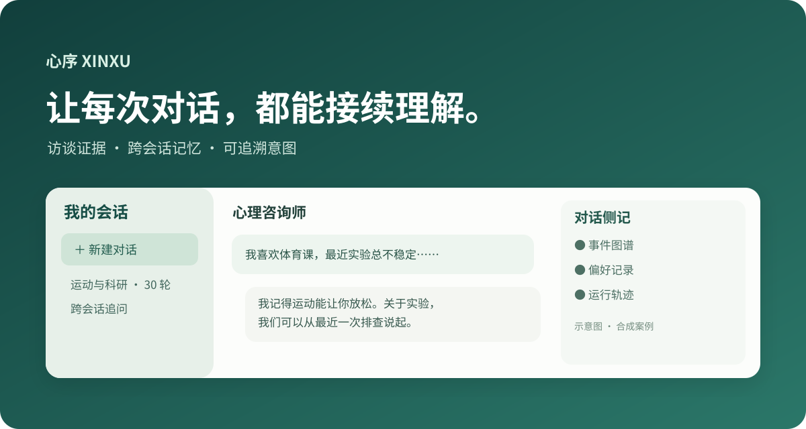
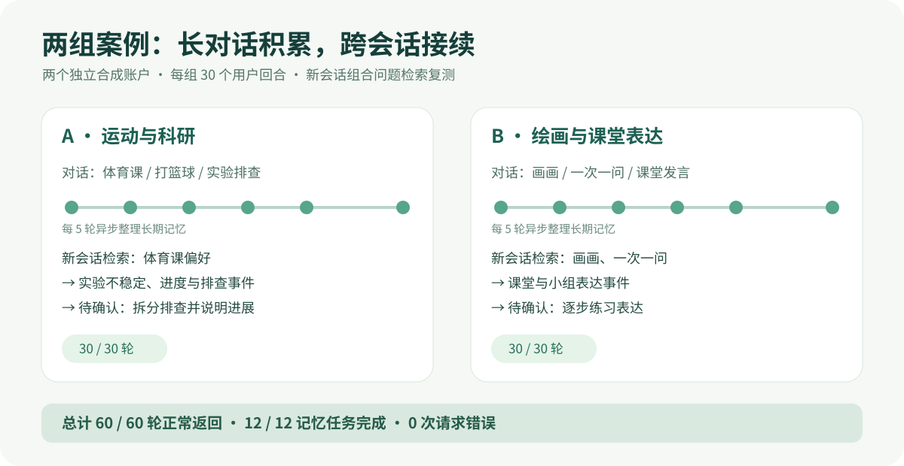
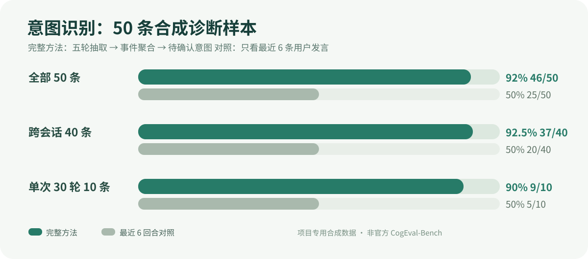
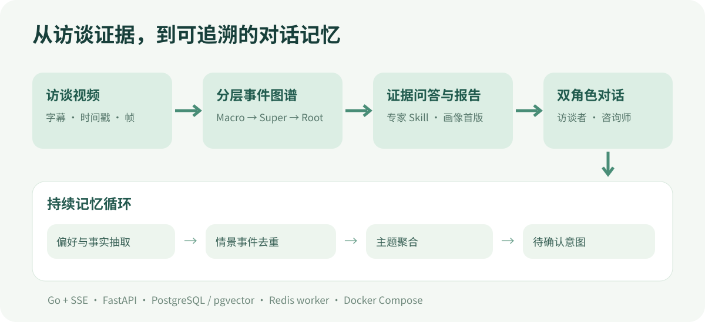

# 心序 · 跨会话咨询记忆工作台

> 从访谈视频生成可核验的画像，再将对话中的偏好、情景事件与待确认意图组织为长期记忆。支持访谈者和咨询师双角色、事件图谱、偏好记录及逐轮运行轨迹。



## 两组案例：30 轮长会话与跨会话追问



两组独立的**合成演示用户**各完成 30 个用户回合及对应回复，再分别新建会话追问。合计 **60/60 轮正常返回、0 次请求错误**；每 5 轮异步整理一次记忆，**12/12 个任务完成**。

| 案例 | 长对话中分散出现的信息 | 新会话检索复测找回 |
| --- | --- | --- |
| A：运动与科研 | 喜欢体育课、每周三打篮球；实验结果不稳定、向导师解释进度和排查记录 | 体育课偏好；相关情景事件；“拆分排查并说明进展”的待确认意图 |
| B：绘画与课堂表达 | 喜欢画画、希望一次只问一个问题；课堂和小组表达的多次经历 | 画画及交流偏好；相关情景事件；“逐步练习表达”的待确认意图 |

原始新会话回复找回了两组兴趣偏好，却漏掉了同一问题中询问的反复经历。定位到组合问题被路由为纯偏好查询后，增加 `event_preference` 路由，分别改写查询并为事件、偏好保留候选配额。**上述跨会话结果是修复后的检索上下文复测；最终咨询师回复尚未重新生成。**见[两组 30 轮报告](LIVE_30TURN_REPORT.md)和[原始对话及任务状态](data/live_30turn_cases.json)。

## 意图识别消融：跨会话与单次长会话



另构造 50 条项目专用合成样本：40 条跨两个会话，10 条在单一 30 回合会话中。完整方法执行五轮记忆抽取、事件去重、事件→主题聚合和意图判定；对照方法只读取最近 6 条用户发言。两组均使用 GPT-6-SOL。完整方法意图二分类准确率 **46/50（92%）**，对照方法 **25/50（50%）**；跨会话 **37/40 对 20/40**，单次 30 回合 **9/10 对 5/10**。这是针对分散证据设计的诊断实验，并非 CogniFold 官方数据集或临床效果评测。协议、错例与逐样本预测见[消融报告](INTENT_ABLATION_REPORT.md)及[数据](data/intent_ablation_50.json)。

## 功能和处理流程



| 模块 | 已实现的功能 |
| --- | --- |
| 视频理解 | `faster-whisper` 生成带时间戳字幕；自下而上构建 Macro → Super → Root；查询时自上而下定位字幕和关键帧，返回证据 ID。 |
| 报告与画像 | 预设问题和专家 Skill 生成访谈问答、报告章节、画像观察；画像作为同一用户的初始长期记忆。 |
| 双角色对话 | Go 网关管理账户与会话；访谈者、咨询师两种模式通过 SSE 流式返回。 |
| 长期记忆 | 每 5 个用户回合异步抽取偏好、事实与人物情景事件；相近事件去重并聚合为主题，形成待确认意图。 |
| 可解释界面 | 可折叠会话栏与侧记栏；展示事件→主题→意图图谱、Markdown 偏好和逐轮 trace。 |

匿名访谈视频案例处理了 **183 段字幕、19 个 Macro、7 个 Super、1 个 Root**，生成 **3 道证据问答、5 个报告章节、11 条画像观察**。详见[访谈案例](CASE_STUDY.md)。

## 技术栈

| 层 | 技术 | 用途 |
| --- | --- | --- |
| 前端 | HTML、CSS、JavaScript、SVG | 聊天、图谱、视频时间轴与证据查看 |
| 网关 | Go、SSE | 账户、会话、双角色聊天和流式输出 |
| 媒体与记忆服务 | Python、FastAPI、FFmpeg、faster-whisper | 视频入库、ASR、建图、报告与记忆抽取 |
| 存储检索 | PostgreSQL、pgvector、FastEmbed 多语言 E5 | 会话和记忆持久化、384 维向量召回 |
| 异步任务 | Redis、Python worker | ASR、建图、报告和五轮记忆整理 |
| 部署 | Docker Compose | 网关、媒体 API、worker、数据库和队列编排 |

更多写入、更新和检索规则见[记忆设计](MEMORY_DESIGN.md)。Concept 节点保存 `support_count` 和 `strength`；目前 `strength` 用于图谱呈现，聊天检索由命中事件向关联主题扩展。

## 启动

复制 `.env.example` 为 `.env`，在本机填写模型配置和数据库密码。将 `PGDATA_HOST_PATH`、`USER_DATA_HOST_PATH` 指向支持 POSIX 权限的目录；演示视频放在 `./media` 并设置 `DEMO_VIDEO_PATH`。随后运行：

```bash
docker compose up --build -d
```

服务器本机访问 `http://127.0.0.1:8080` 并注册账户。远程使用需先建立 SSH 端口转发。视频入库示例：

```bash
curl -X POST http://127.0.0.1:8080/api/videos \
  -H 'Content-Type: application/json' \
  -d '{"video_id":"interview-demo","path":"/media/interview.mp4"}'
```

异步任务可查询 `/api/jobs/{id}` 或订阅 `/api/jobs/{id}/events`。模型通过 OpenAI 兼容接口配置；首次 ASR 运行可能下载模型。仓库不包含访谈原视频、学生报告、密钥或运行数据库。英文旧版说明见 [README_EN.md](README_EN.md)。
